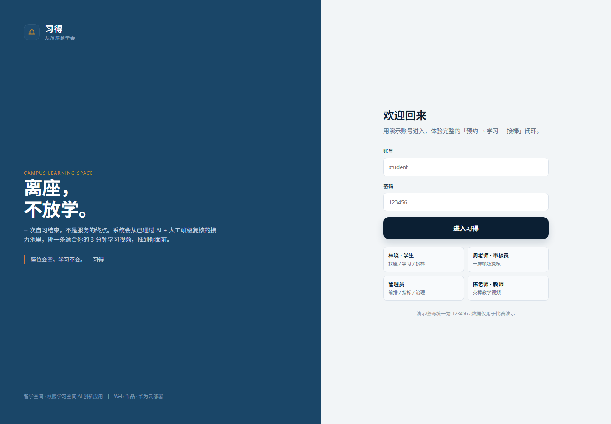
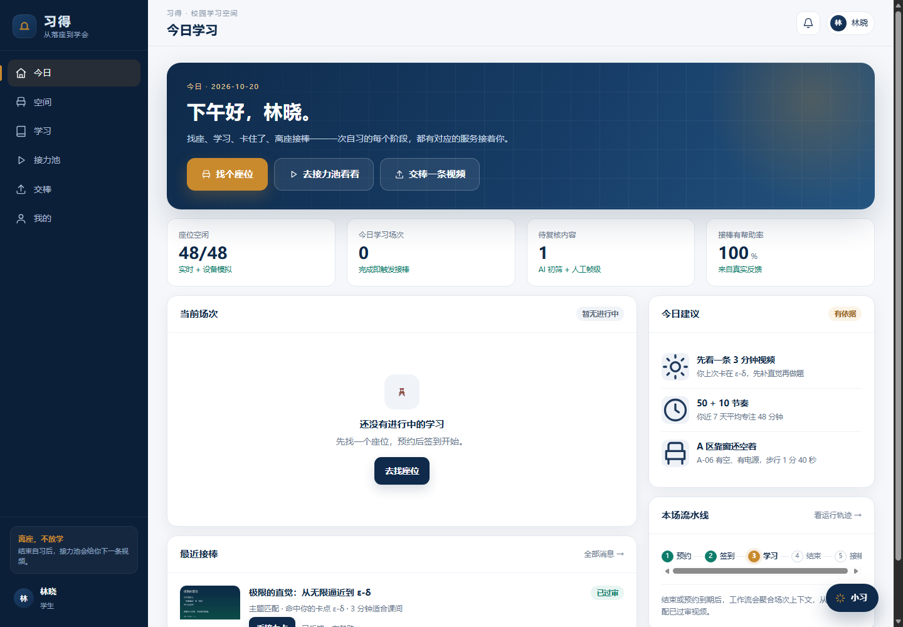
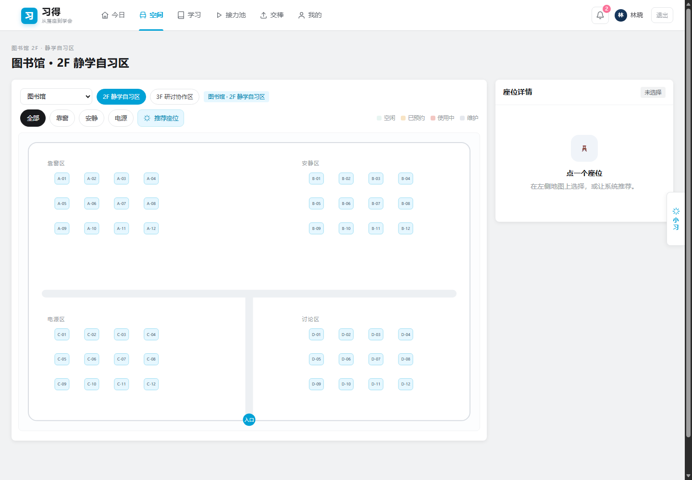
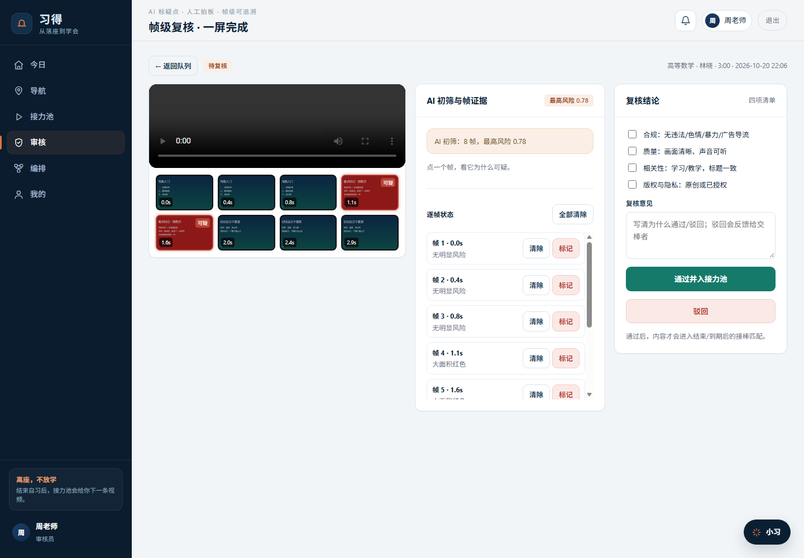
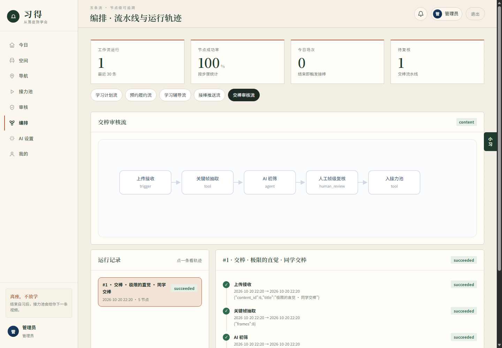
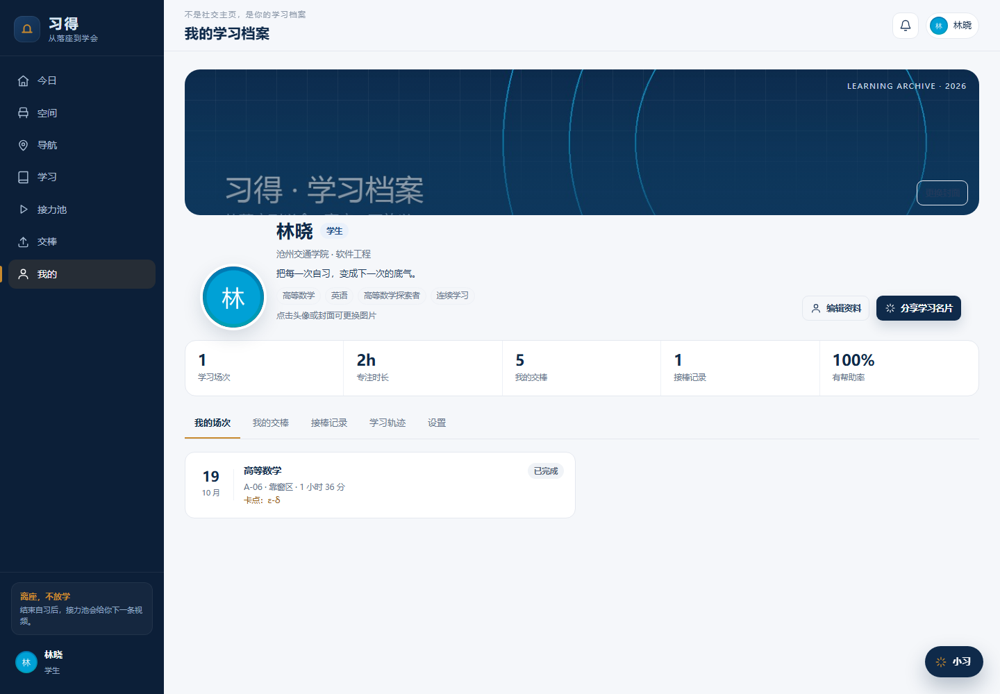
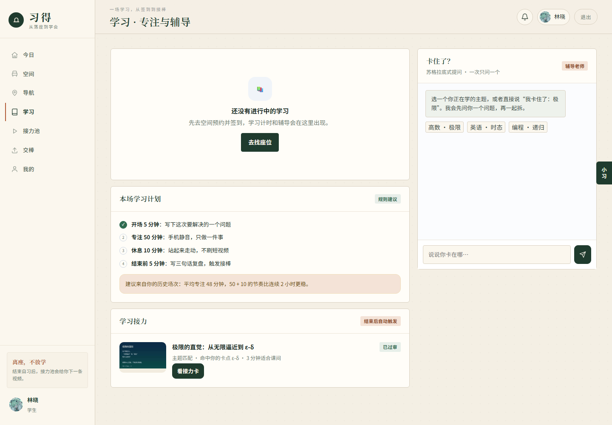
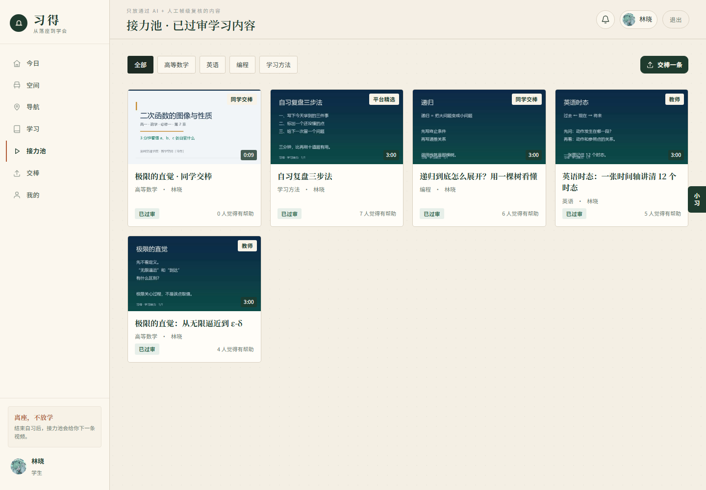
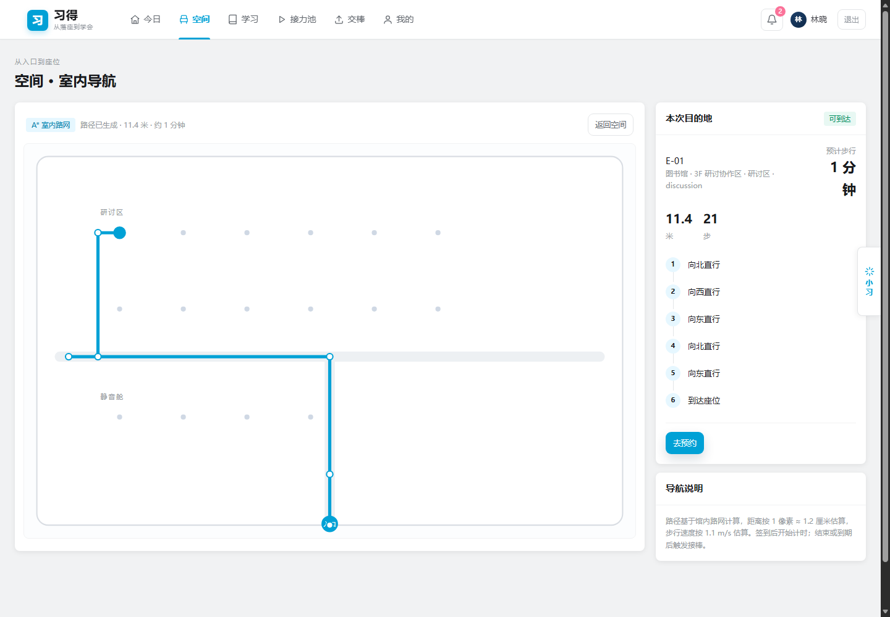
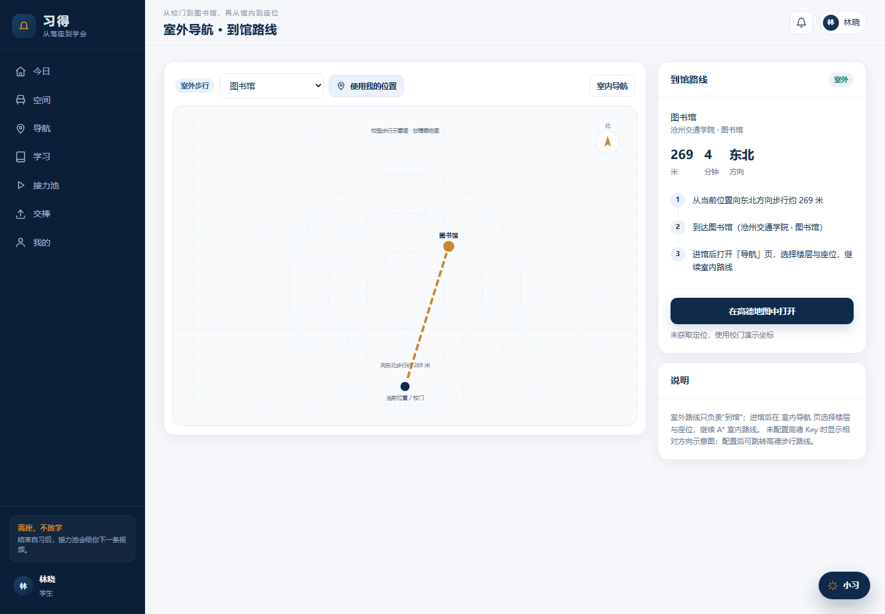

# 习得 · 校园学习空间智能体

> **从落座到学会。离座，不放学。**

「习得」是一个云上部署的 Web 学习空间：学生找座、预约、导航、学习、卡住了辅导，结束或预约到期后，系统从**已通过 AI + 人工帧级复核**的接力池里匹配一条学习视频，推给本人；学生也可以「交棒」自己的学习/教学视频，经抽帧、AI 初筛、人工一屏复核后进入接力池。

本仓库是华为 ICT 创新赛赛道 1 的校赛 Demo 最小闭环，融合了三个既有作品的**能力**（不是页面/业务外壳）：

| 原作品 | 在本项目中的角色 |
|---|---|
| 校园创意文化展示站 | 交棒流水线：上传、抽帧、AI 初筛、人工复核、审核状态 |
| 智能选座与导航 | 接棒流水线：座位图、预约、A* 导航、结束事件 |
| 农技宝任务流 | 编排引擎：意图路由、澄清、苏格拉底辅导、状态传递、异常兜底 |

## 功能

- 学生端：登录、今日建议、**选座页先选地点再选座**、座位地图、筛选、预约、A* 室内导航、签到、学习计时、卡住了辅导、结束/预约到期、接棒卡、反馈、**个人主页（头像/封面/昵称可改）**
- 审核端：待复核队列、一屏帧级工作台（视频 + 帧时间轴 + AI 理由 + 四项清单 + 通过/驳回 + 帧级状态）
- 编排端：五条工作流（学习计划/预约/学习辅导/接棒推送/交棒审核）的节点图、运行记录、节点日志
- 内容端：交棒上传、抽帧、AI 初筛、入接力池、按学科浏览
- 智能体：全局小习浮窗、规则意图路由、座位推荐理由、辅导对话、内容推荐理由；无大模型时全部规则兜底
- 空间感知：ESP32 上报 API + 管理端设备模拟器（设备状态只补充实时在场，不覆盖预约）
- 多建筑/多楼层：选座页先选地点（建筑 + 楼层），再选座位；演示含图书馆 2F/3F、教学楼 A 1F，共 79 座
- 室外导航：校门 → 图书馆/教学楼 A，显示距离、方向、步行时间，可跳转手机地图；配置 AMAP_JS_KEY 后可扩展高德路线
- 个人主页：点击头像/封面即可上传更换，编辑昵称/学院/学习签名/兴趣方向

## 快速启动

要求：Python 3.10+（本机 Python 3.14 已验证），Node 仅用于可选的截图脚本。

```bash
cd D:\华为ICT\zhixue-space
python -m pip install -r requirements.txt
python seed.py --reset      # 生成 79 座位 / 4 用户 / 5 条内容 / 关键帧
python app.py               # http://127.0.0.1:5820
```

演示账号（密码均 `123456`）：

| 账号 | 角色 | 用途 |
|---|---|---|
| `student` | 学生 林晓 | 找座、学习、接棒、交棒 |
| `reviewer` | 审核员 周老师 | 一屏帧级复核 |
| `admin` | 管理员 | 编排、指标、设备模拟 |
| `teacher` | 教师 陈老师 | 交棒教学视频 |

## 4 分钟演示路线

1. 学生登录 → 首页「今日建议」→ 空间找座（推荐 A-06，给理由）
2. 预约 → 导航 → 签到 → 学习页计时
3. 点「卡住了」→ 高数极限 → 两轮苏格拉底 → 推荐视频
4. 结束学习或「演示：预约到期」→ 接棒卡 → 看视频 → 有帮助
5. 审核员登录 → 审核队列 → 一屏帧级复核 → 通过/驳回
6. 管理员登录 → 编排页 → 五条流、运行轨迹、节点日志

详细分镜见 `docs/DEMO-SCRIPT.md`。

## 截图

| 登录 | 首页 | 空间 |
|---|---|---|
|  |  |  |

| 一屏帧级复核 | 编排 | 学习档案 |
|---|---|---|
|  |  |  |

| 学习页 | 接力池 | 室内导航 |
|---|---|---|
|  |  |  |

| 室外导航 |
|---|
|  |

> 完整介绍见 [docs/项目详细介绍.md](docs/项目详细介绍.md)；Word 版：[docs/习得-项目详细介绍.docx](docs/习得-项目详细介绍.docx)。

## 架构

```
Web（Jinja + 原生 JS + SVG，无 CDN 依赖）
  ├─ 学生端：今日 / 空间 / 学习 / 接力池 / 交棒 / 我的
  ├─ 审核端：队列 / 一屏帧级工作台
  └─ 编排端：五条流 / 运行轨迹 / 指标
        │
Flask 应用层（app.py）
  ├─ services/seats.py        座位/预约/签到/结束/到期扫描
  ├─ services/navigation.py   A* 室内导航
  ├─ services/content.py      抽帧/AI 初筛/帧级复核/匹配
  ├─ services/relay.py        接棒推送/反馈/幂等
  ├─ services/agents.py       意图路由 + 只读工具
  ├─ services/tutor.py        2–3 主题苏格拉底辅导
  ├─ services/flow.py         工作流引擎（run/step/context）
  └─ services/devices.py      ESP32 上报 + 模拟器
        │
SQLite（本地）/ RDS MySQL（云上）
本地文件（本地）/ OBS（云上）
```

## 目录

```
zhixue-space/
  app.py                  Flask 路由与页面入口
  seed.py                 演示数据（用户/48 座位/路网/内容/关键帧）
  db.py                   SQLite 访问层与建表
  services/               业务服务（见上）
  templates/              页面模板
  static/css/app.css      设计系统
  static/js/app.js        公共 JS / 全局助手
  tests/                  75 条自动化测试
  docs/                   产品、架构、UI、华为云、演示脚本
  data/                   运行时数据（gitignore）
```

## 关键 API

| 方法 | 路径 | 说明 |
|---|---|---|
| POST | `/api/auth/login` | 登录 |
| GET | `/api/seats?floor_id=1` | 座位实时状态 |
| POST | `/api/bookings` | 预约 |
| POST | `/api/bookings/<id>/checkin` | 签到 |
| POST | `/api/bookings/<id>/end` | 结束并触发接棒 |
| GET | `/api/nav?seat_id=1` | A* 路径 |
| POST | `/api/tutor/start` / `answer` | 卡住了辅导 |
| POST | `/api/agent/ask` | 小习助手 |
| POST | `/api/contents` | 交棒上传 |
| GET | `/api/review/queue` / `/<id>` | 审核队列/详情 |
| POST | `/api/review/<id>/decision` | 帧级复核结论 |
| GET | `/api/relay/pending` | 接棒记录 |
| POST | `/api/relay/<id>/feedback` | 有帮助/没帮助 |
| GET | `/api/workflow/runs` | 运行轨迹 |
| POST | `/api/sensor/report` | ESP32 上报 |

## 测试

```bash
python -m pytest -q
# 75 passed
```

测试覆盖：内容抽帧/初筛/复核/匹配（15）、工作流（对端 A）、智能体与辅导（对端 A）、座位冲突/签到结束/到期/接棒幂等/导航/智能体契约（主会话）。

## 已知边界

- AI 初筛是**规则代理**（红色/暗部/模糊/文本关键词）+ 可插拔云服务适配器，不是“全自动判定”；人工帧级复核是必须的。
- 演示视频为合成短片，内容元数据按 3 分钟展示；真实视频需按 `docs/CONTRACT.md` 的接口接入。
- 本地用 SQLite/本地文件；云上 RDS/Redis/OBS 的映射与部署步骤见 `docs/HUAWEI-CLOUD.md`。
- 真实 ESP32 设备未接入演示，默认使用模拟器；上报 API 已与固件字段对齐。
- 没有做点赞/评论/关注/信息流——这是刻意的：本作品不是校园视频站，是学习接力。

## 华为云

- CodeArts 代码智能体：需求理解 → 代码生成 → 构建 → 修复 → 部署，证据清单见 `docs/HUAWEI-CLOUD.md`。
- RDS：业务记录；Redis：抢座锁/幂等/队列；OBS：视频与关键帧；MaaS：意图/辅导/理由生成（可选，规则兜底）。

## License

MIT，见 `LICENSE`。
